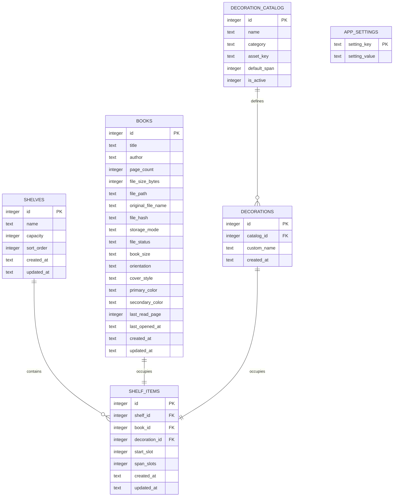

# Foliora - Database Schema Specification

## 1. Overview

Foliora uses SQLite as its local database. The database manages shelves, books, decorative objects, shelf-item positions, and application preferences.

The main design principle is to keep book and decoration information separate from shelf placement. Items can then be moved without changing their core information.

The database is owned by the Rust backend. The frontend never runs SQL directly. It calls Tauri commands (`add_book`, `move_item`, `swap_books`, and so on) that validate input, run the change in a transaction, and return either the updated state or an error.

## 2. Tables

| Table                | Responsibility                                                   |
| -------------------- | ---------------------------------------------------------------- |
| `shelves`            | Stores shelf information and capacity.                           |
| `books`              | Stores book metadata, PDF file references, and reading progress. |
| `decoration_catalog` | Stores definitions of available decorative objects.              |
| `decorations`        | Stores individual decorative objects added by the user.          |
| `shelf_items`        | Stores the position and space occupied by books and decorations. |
| `app_settings`       | Stores application preferences.                                  |

The schema version is tracked with `PRAGMA user_version` (see section 8).

## 3. Entity Relationships



## 4. Table Specifications

### 4.1. `shelves`

| Column       | Type    | Description                              |
| ------------ | ------- | ---------------------------------------- |
| `id`         | INTEGER | Primary key                              |
| `name`       | TEXT    | Shelf name                               |
| `capacity`   | INTEGER | Total spaces, between 1 and 60.          |
| `sort_order` | INTEGER | Display order. The backend keeps it contiguous (1..n). |
| `created_at` | TEXT    | Creation timestamp                       |
| `updated_at` | TEXT    | Last update timestamp (set by trigger)   |

On first run, 4 shelves of 24 spaces are created.

`sort_order` is not unique, because a unique column would make reordering run into the same problem as swaps. The backend rewrites the order of all shelves in one transaction.

### 4.2. `books`

| Column               | Type    | Description                                                         |
| -------------------- | ------- | ------------------------------------------------------------------- |
| `id`                 | INTEGER | Primary key                                                         |
| `title`              | TEXT    | Book title. Defaults to the file name if the PDF has no title.      |
| `author`             | TEXT    | Author name; nullable.                                              |
| `page_count`         | INTEGER | Total pages, read from the PDF; greater than zero.                  |
| `file_size_bytes`    | INTEGER | PDF file size in bytes.                                             |
| `file_path`          | TEXT    | See "File paths" below.                                             |
| `original_file_name` | TEXT    | File name at import time, for display and relinking.                |
| `file_hash`          | TEXT    | SHA-256 of the PDF (hex). Used for duplicate detection and relink checks. |
| `storage_mode`       | TEXT    | `COPY` or `LINK`.                                                   |
| `file_status`        | TEXT    | `AVAILABLE` or `MISSING`.                                           |
| `book_size`          | TEXT    | `A5` or `B5`; default `B5`.                                         |
| `orientation`        | TEXT    | `VERTICAL` or `HORIZONTAL`; default `VERTICAL`.                     |
| `cover_style`        | TEXT    | `BOTTOM_BAND`, `CENTER_LABEL`, or `DOUBLE_STRIPE`.                  |
| `primary_color`      | TEXT    | Cover color, `#RRGGBB`.                                             |
| `secondary_color`    | TEXT    | Accent color, `#RRGGBB`.                                            |
| `last_read_page`     | INTEGER | Page restored when the book is reopened; default 1.                 |
| `last_opened_at`     | TEXT    | Last time the book was opened; nullable.                            |
| `created_at`         | TEXT    | Creation timestamp.                                                 |
| `updated_at`         | TEXT    | Last update timestamp (set by trigger).                             |

**File paths:**

- `COPY`: the path is **relative** to the managed folder (`<app_data_dir>/books/`), for example `3f2a…c1.pdf`. This lets the data directory move without breaking records. The backend rejects any stored relative path that is absolute or contains `..`.
- `LINK`: the path is the **absolute** path chosen by the user.

`file_hash` is indexed but not unique. Duplicates are allowed after the user confirms the warning.

A book's shelf position is not stored in this table. It is stored in `shelf_items`.

### 4.3. `decoration_catalog`

Stores definitions of the built-in decorative objects. It is seeded by a migration.

| Column         | Type    | Description                                |
| -------------- | ------- | ------------------------------------------ |
| `id`           | INTEGER | Primary key                                |
| `name`         | TEXT    | Decoration name                            |
| `category`     | TEXT    | Object category                            |
| `asset_key`    | TEXT    | Unique image or asset identifier           |
| `default_span` | INTEGER | Number of shelf spaces occupied.           |
| `is_active`    | INTEGER | Whether the item is offered; `0` or `1`.   |

Example:

| id | name           | category   | default_span |
| -- | -------------- | ---------- | ------------ |
| 1  | Classic Vase   | DECORATION | 2            |
| 2  | Desk Clock     | DECORATION | 1            |
| 3  | Paper Calendar | STATIONERY | 1            |
| 4  | Indoor Plant   | PLANT      | 2            |
| 5  | Globe          | DECORATION | 2            |

Catalog entries are never deleted. Retired entries are set to `is_active = 0`, so existing placed decorations keep working.

### 4.4. `decorations`

Stores individual decorative objects added by users.

| Column        | Type    | Description                         |
| ------------- | ------- | ----------------------------------- |
| `id`          | INTEGER | Primary key                         |
| `catalog_id`  | INTEGER | References `decoration_catalog.id`. |
| `custom_name` | TEXT    | Optional user-defined name.         |
| `created_at`  | TEXT    | Creation timestamp.                 |

For example, a user may add three clocks to different shelves. They share one catalog definition, but each is an independent decoration with its own shelf position.

### 4.5. `shelf_items`

This is the central positioning table for both books and decorative objects.

| Column          | Type    | Description                                     |
| --------------- | ------- | ----------------------------------------------- |
| `id`            | INTEGER | Primary key                                     |
| `shelf_id`      | INTEGER | References `shelves.id`.                        |
| `book_id`       | INTEGER | References `books.id`; nullable; unique.        |
| `decoration_id` | INTEGER | References `decorations.id`; nullable; unique.  |
| `start_slot`    | INTEGER | First occupied space (1-based).                 |
| `span_slots`    | INTEGER | Number of spaces occupied.                      |
| `created_at`    | TEXT    | Placement creation timestamp.                   |
| `updated_at`    | TEXT    | Last position update timestamp (set by trigger).|

Exactly one of `book_id` or `decoration_id` must be populated for each row.

**Span is derived, then stored.** `span_slots` is computed by the backend, never entered by the user. It is stored so the database triggers can check occupancy.

- Books: from `book_size`, `orientation`, and `page_count`, using the span table in the product spec (section 2.3).
- Decorations: from `decoration_catalog.default_span`.

When a book edit changes its span, the backend updates `span_slots` in the same transaction, and the triggers reject the edit if the book no longer fits.

Example: a shelf with 10 spaces.

| Item   | Start Slot | Span | Occupied Slots |
| ------ | ---------- | ---- | -------------- |
| Book A | 1          | 1    | 1              |
| Book B | 2          | 1    | 2              |
| Vase   | 3          | 2    | 3, 4           |
| Book C | 5          | 4    | 5, 6, 7, 8     |
| Clock  | 9          | 1    | 9              |

Slot 10 remains available.

### 4.6. `app_settings`

| Column          | Type | Description                     |
| --------------- | ---- | ------------------------------- |
| `setting_key`   | TEXT | Primary key; setting identifier.|
| `setting_value` | TEXT | Setting value.                  |

Example:

| setting_key            | setting_value |
| ---------------------- | ------------- |
| `theme`                | `dark`        |
| `default_book_size`    | `B5`          |
| `default_orientation`  | `VERTICAL`    |
| `default_storage_mode` | `COPY`        |

## 5. SQLite Schema (DDL)

```sql
-- Run on every connection, before anything else.
PRAGMA foreign_keys = ON;
PRAGMA journal_mode = WAL;
PRAGMA busy_timeout = 5000;

-- 1. Shelves
CREATE TABLE shelves (
    id INTEGER PRIMARY KEY,
    name TEXT NOT NULL CHECK (length(trim(name)) > 0),
    capacity INTEGER NOT NULL CHECK (capacity BETWEEN 1 AND 60),
    sort_order INTEGER NOT NULL DEFAULT 0,
    created_at TEXT NOT NULL DEFAULT CURRENT_TIMESTAMP,
    updated_at TEXT NOT NULL DEFAULT CURRENT_TIMESTAMP
);

-- 2. Books
CREATE TABLE books (
    id INTEGER PRIMARY KEY,
    title TEXT NOT NULL CHECK (length(trim(title)) > 0),
    author TEXT,
    page_count INTEGER NOT NULL CHECK (page_count > 0),
    file_size_bytes INTEGER NOT NULL CHECK (file_size_bytes >= 0),
    file_path TEXT NOT NULL,
    original_file_name TEXT NOT NULL,
    file_hash TEXT NOT NULL,
    storage_mode TEXT NOT NULL
        CHECK (storage_mode IN ('COPY', 'LINK')),
    file_status TEXT NOT NULL DEFAULT 'AVAILABLE'
        CHECK (file_status IN ('AVAILABLE', 'MISSING')),
    book_size TEXT NOT NULL DEFAULT 'B5'
        CHECK (book_size IN ('A5', 'B5')),
    orientation TEXT NOT NULL DEFAULT 'VERTICAL'
        CHECK (orientation IN ('VERTICAL', 'HORIZONTAL')),
    cover_style TEXT NOT NULL DEFAULT 'BOTTOM_BAND'
        CHECK (cover_style IN ('BOTTOM_BAND', 'CENTER_LABEL', 'DOUBLE_STRIPE')),
    primary_color TEXT NOT NULL
        CHECK (primary_color GLOB '#[0-9A-Fa-f][0-9A-Fa-f][0-9A-Fa-f][0-9A-Fa-f][0-9A-Fa-f][0-9A-Fa-f]'),
    secondary_color TEXT NOT NULL
        CHECK (secondary_color GLOB '#[0-9A-Fa-f][0-9A-Fa-f][0-9A-Fa-f][0-9A-Fa-f][0-9A-Fa-f][0-9A-Fa-f]'),
    last_read_page INTEGER NOT NULL DEFAULT 1 CHECK (last_read_page >= 1),
    last_opened_at TEXT,
    created_at TEXT NOT NULL DEFAULT CURRENT_TIMESTAMP,
    updated_at TEXT NOT NULL DEFAULT CURRENT_TIMESTAMP
);

-- 3. Decoration Catalog
CREATE TABLE decoration_catalog (
    id INTEGER PRIMARY KEY,
    name TEXT NOT NULL,
    category TEXT NOT NULL,
    asset_key TEXT NOT NULL UNIQUE,
    default_span INTEGER NOT NULL DEFAULT 1 CHECK (default_span > 0),
    is_active INTEGER NOT NULL DEFAULT 1 CHECK (is_active IN (0, 1))
);

-- 4. Decorations
CREATE TABLE decorations (
    id INTEGER PRIMARY KEY,
    catalog_id INTEGER NOT NULL
        REFERENCES decoration_catalog(id) ON DELETE RESTRICT,
    custom_name TEXT,
    created_at TEXT NOT NULL DEFAULT CURRENT_TIMESTAMP
);

-- 5. Shelf Items
CREATE TABLE shelf_items (
    id INTEGER PRIMARY KEY,
    shelf_id INTEGER NOT NULL
        REFERENCES shelves(id) ON DELETE RESTRICT,
    book_id INTEGER UNIQUE
        REFERENCES books(id) ON DELETE CASCADE,
    decoration_id INTEGER UNIQUE
        REFERENCES decorations(id) ON DELETE CASCADE,
    start_slot INTEGER NOT NULL CHECK (start_slot > 0),
    span_slots INTEGER NOT NULL CHECK (span_slots > 0),
    created_at TEXT NOT NULL DEFAULT CURRENT_TIMESTAMP,
    updated_at TEXT NOT NULL DEFAULT CURRENT_TIMESTAMP,

    UNIQUE (shelf_id, start_slot),
    CHECK (
        (book_id IS NOT NULL AND decoration_id IS NULL)
        OR
        (book_id IS NULL AND decoration_id IS NOT NULL)
    )
);

-- 6. Application Settings
CREATE TABLE app_settings (
    setting_key TEXT PRIMARY KEY,
    setting_value TEXT NOT NULL
);

-- Indexes
-- (shelf_id, start_slot) is already indexed by its UNIQUE constraint.
CREATE INDEX idx_books_title ON books(title);
CREATE INDEX idx_books_file_hash ON books(file_hash);
CREATE INDEX idx_decorations_catalog ON decorations(catalog_id);
```

## 6. Triggers and Business Rules

### 6.1. Prevent Overlap and Overflow

Ordinary unique constraints cannot stop two items from occupying overlapping slot ranges (for example, slots 1–3 and 3–5). Triggers check capacity and overlap on every insert and on every position or span change.

```sql
CREATE TRIGGER shelf_items_validate_insert
BEFORE INSERT ON shelf_items
BEGIN
    SELECT RAISE(ABORT, 'Item exceeds shelf capacity')
    WHERE NEW.start_slot + NEW.span_slots - 1 >
          (SELECT capacity FROM shelves WHERE id = NEW.shelf_id);

    SELECT RAISE(ABORT, 'Shelf position is occupied')
    WHERE EXISTS (
        SELECT 1 FROM shelf_items e
        WHERE e.shelf_id = NEW.shelf_id
          AND NEW.start_slot <= e.start_slot + e.span_slots - 1
          AND NEW.start_slot + NEW.span_slots - 1 >= e.start_slot
    );
END;

CREATE TRIGGER shelf_items_validate_update
BEFORE UPDATE OF shelf_id, start_slot, span_slots ON shelf_items
BEGIN
    SELECT RAISE(ABORT, 'Item exceeds shelf capacity')
    WHERE NEW.start_slot + NEW.span_slots - 1 >
          (SELECT capacity FROM shelves WHERE id = NEW.shelf_id);

    SELECT RAISE(ABORT, 'Shelf position is occupied')
    WHERE EXISTS (
        SELECT 1 FROM shelf_items e
        WHERE e.shelf_id = NEW.shelf_id
          AND e.id != OLD.id
          AND NEW.start_slot <= e.start_slot + e.span_slots - 1
          AND NEW.start_slot + NEW.span_slots - 1 >= e.start_slot
    );
END;
```

The error messages are stable strings. The backend maps them to typed errors for the UI.

### 6.2. Prevent Invalid Capacity Changes

If an item occupies slots 13–15, the shelf's capacity cannot be reduced below 15.

```sql
CREATE TRIGGER shelves_validate_capacity
BEFORE UPDATE OF capacity ON shelves
BEGIN
    SELECT RAISE(ABORT, 'Capacity is smaller than occupied space')
    WHERE EXISTS (
        SELECT 1 FROM shelf_items
        WHERE shelf_id = NEW.id
          AND start_slot + span_slots - 1 > NEW.capacity
    );
END;
```

The backend also checks this first, so it can tell the user which items block the change.

### 6.3. Maintain `updated_at`

```sql
CREATE TRIGGER shelves_touch AFTER UPDATE ON shelves
WHEN NEW.updated_at = OLD.updated_at
BEGIN
    UPDATE shelves SET updated_at = CURRENT_TIMESTAMP WHERE id = NEW.id;
END;

CREATE TRIGGER books_touch AFTER UPDATE ON books
WHEN NEW.updated_at = OLD.updated_at
BEGIN
    UPDATE books SET updated_at = CURRENT_TIMESTAMP WHERE id = NEW.id;
END;

CREATE TRIGGER shelf_items_touch AFTER UPDATE ON shelf_items
WHEN NEW.updated_at = OLD.updated_at
BEGIN
    UPDATE shelf_items SET updated_at = CURRENT_TIMESTAMP WHERE id = NEW.id;
END;
```

The `WHEN` guard stops these triggers from re-firing themselves. Updating only `updated_at` does not fire the validation triggers, because they watch specific columns.

### 6.4. Moving and Exchanging Items

All position changes run inside `BEGIN IMMEDIATE … COMMIT`, and any trigger error rolls back the whole transaction.

**Move:** a single `UPDATE shelf_items SET shelf_id = ?, start_slot = ? WHERE id = ?`. The update trigger validates it.

**Exchange (books only):** the per-row trigger would reject the first `UPDATE`, because the other book still occupies the target. Delete both placements and reinsert them at their new positions, keeping the original `created_at`:

```sql
BEGIN IMMEDIATE;
DELETE FROM shelf_items WHERE id IN (:a_id, :b_id);
INSERT INTO shelf_items (shelf_id, book_id, start_slot, span_slots, created_at)
VALUES (:a_new_shelf, :a_book, :a_new_start, :a_span, :a_created_at);
INSERT INTO shelf_items (shelf_id, book_id, start_slot, span_slots, created_at)
VALUES (:b_new_shelf, :b_book, :b_new_start, :b_span, :b_created_at);
COMMIT;
```

New positions follow the exchange rule in the product spec (section 3.7):

- **Different shelves:** `a_new = (b.shelf, b.start)` and `b_new = (a.shelf, a.start)`.
- **Same shelf**, where `L` is the item with the lower `start_slot` and `R` is the other:
  - `R_new_start = L.start`
  - `L_new_start = R.start + R.span - L.span`

`shelf_items.id` is not referenced anywhere else, so reinserting is safe.

### 6.5. Referential Integrity

- A shelf can only be deleted when it has no items (`ON DELETE RESTRICT`). The UI asks the user to move or remove the items first.
- Deleting a book or decoration removes its placement (`ON DELETE CASCADE`).
- Catalog entries referenced by decorations cannot be deleted (`ON DELETE RESTRICT`). They are deactivated instead.
- A book or decoration has at most one placement (`UNIQUE`).
- Every placement references exactly one book or one decoration (`CHECK`).
- **Every book and decoration is placed.** Creating a book and its placement happens in one transaction. The database permits an unplaced row, but the backend never leaves one behind.

### 6.6. Files and the Database

SQLite stores file references only, never PDF content. The rules below keep files and rows in sync.

- **Add (COPY):**
  1. Write the file to `books/<uuid>.pdf.tmp`.
  2. Rename it to `books/<uuid>.pdf`.
  3. Insert the book and its placement in one transaction.
  4. If step 3 fails, delete the copied file.
- **Remove (COPY):** delete the row first. Delete the file only if the user chose to, and only after the commit succeeds.
- **Remove (LINK):** never touch the original file.
- **Missing check:** on startup and on open, `LINK` books whose file is missing are set to `MISSING`, and books that are found again are set back to `AVAILABLE`.
- **Relink:** update `file_path`, set `file_status = 'AVAILABLE'`, and compare `file_hash`. If the hash differs, show a warning, and store the new hash and page count only after the user confirms.

## 7. Important Design Decisions

1. **Books and positions are separate.** A book's identity and PDF information do not depend on its shelf location.
2. **One positioning table.** Books and decorations share `shelf_items`, so occupancy has a single source of truth.
3. **One item, one position.** Every book and decoration is placed exactly once.
4. **Shelves must be emptied before deletion.** Books never silently disappear from view.
5. **Span is derived.** The backend computes it from book attributes or the catalog, and stores it for the triggers.
6. **Validation lives in two places.** The frontend runs the pure placement rules for instant drag feedback. The backend and triggers are authoritative.
7. **All position changes are atomic.** A move, exchange, or span change either completes or leaves the arrangement unchanged.
8. **Paths are portable.** Copied files are stored relative to the managed folder.
9. **Pragmas run on every connection.** `foreign_keys` is per-connection in SQLite and is off by default.

## 8. Migrations

- Migrations are numbered SQL files embedded in the Rust binary (`src-tauri/migrations/0001_init.sql`, …).
- On startup, the backend reads `PRAGMA user_version`, applies each newer migration in its own transaction, and then sets `user_version` to that migration's number.
- Before migrating an existing database, the backend copies the file to `foliora.db.bak`.
- Planned migrations:
  - `0001_init`: all tables (including `decoration_catalog` and `decorations`, because `shelf_items` references them), triggers, indexes, and the default 4 × 24 shelves.
  - `0002_decorations`: catalog seed data.

## 9. Implementation Checklist

- [x] Connection setup with pragmas.
- [x] Migration runner using `user_version`.
- [x] `0001_init`: tables, triggers, indexes, default shelves.
- [x] Tests for overlap, capacity, capacity shrink, and the unique constraint.
- [ ] Tests for move and exchange (same shelf, different shelves, unequal spans, rollback on failure).
- [ ] Tests for book edits that change span (accepted and rejected).
- [ ] Tests for cascade and restrict behaviour on delete.
- [ ] `0002_decorations` with seed data.
